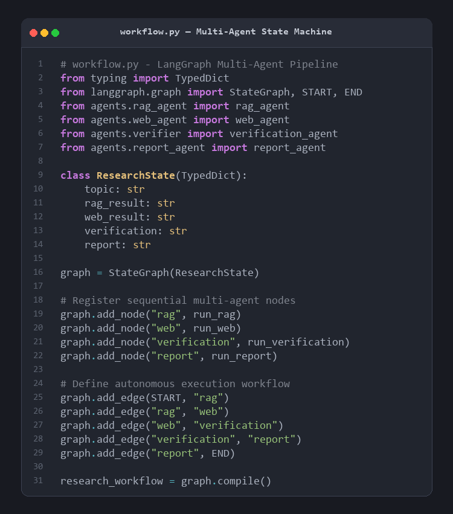
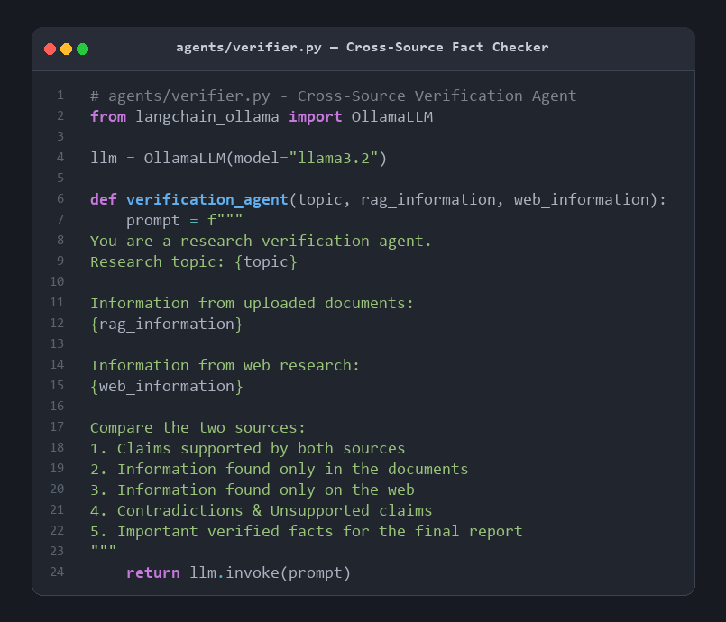
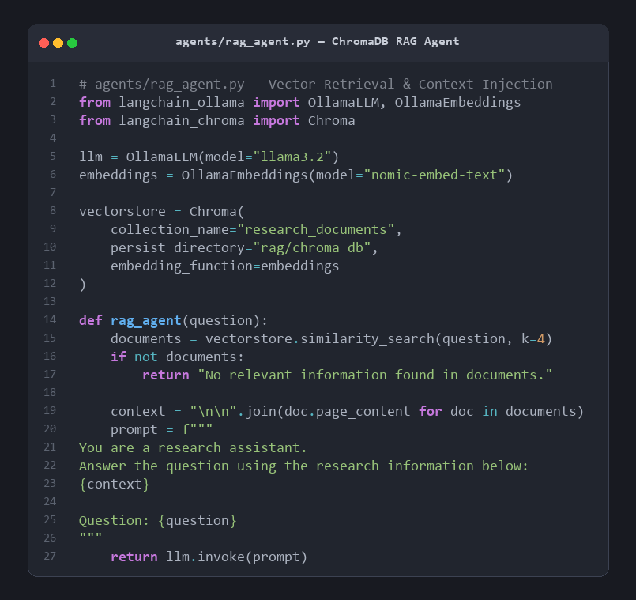

# 🤖 Multi-Agent AI Research Assistant

An intelligent, multi-agent research assistant powered by **LangGraph**, **Ollama**, **ChromaDB**, and **Streamlit**. It automates deep literature reviews by combining document-based retrieval (RAG) with real-time web search, cross-source fact verification, and comprehensive report generation.

---

## 🌟 Key Features

- **Document Ingestion (RAG)**: Upload PDF papers; chunks and embeds text into ChromaDB using Ollama's `nomic-embed-text`.
- **Multi-Agent Orchestration**: Powered by LangGraph:
  1. **RAG Agent**: Retrieves relevant evidence from local research documents.
  2. **Web Agent**: Searches the web for recent literature, news, and external sources via DuckDuckGo.
  3. **Verification Agent**: Cross-verifies local PDF claims against web search findings to detect consensus, discrepancies, and unsupported claims.
  4. **Report Generator Agent**: Synthesizes all findings into a structured academic research report.
- **Interactive Streamlit UI**: User-friendly interface to upload papers, specify topics, and track execution.
- **Export Formats**: Download reports directly as Markdown (`.md`) or PDF generated via ReportLab.
- **Private & Local**: Runs locally using Ollama (`llama3.2`), keeping your research documents secure.

---

## 🏗️ Architecture

```
User Query + Uploaded PDFs
           │
           ▼
    [Document RAG]  <── (ChromaDB + nomic-embed-text)
           │
           ▼
      [Web Research]  <── (DuckDuckGo Search)
           │
           ▼
  [Fact Verification]  (Cross-checks PDF vs. Web findings)
           │
           ▼
  [Report Generation]  (Synthesizes comprehensive findings)
           │
           ▼
    Markdown & PDF Export
```

---

## 📸 Core Implementation Highlights

### 1. LangGraph Multi-Agent State Machine (`workflow.py`)

*Coordinates sequential execution across RAG, Web Search, Verification, and Report Generation agents using a unified `ResearchState` schema.*

### 2. Cross-Source Fact Verification Agent (`agents/verifier.py`)

*Acts as an automated peer reviewer comparing claims between uploaded PDFs and live web search data to detect consensus and flag contradictions.*

### 3. ChromaDB Vector Store & Local RAG (`agents/rag_agent.py`)

*Embeds research documents locally with `nomic-embed-text` and performs dense semantic retrieval to supply grounded evidence.*

---

## 📋 Prerequisites

1. **Python 3.10+**
2. **[Ollama](https://ollama.ai/)** installed and running on your system.
3. Download required models via Ollama:
   ```bash
   ollama pull llama3.2
   ollama pull nomic-embed-text
   ```

---

## 🚀 Getting Started

### 1. Clone the Repository
```bash
git clone https://github.com/Sanjith10-git/autonomous-literature-review-agent.git
cd autonomous-literature-review-agent
```

### 2. Create and Activate a Virtual Environment
```bash
# Windows (PowerShell)
python -m venv venv
.\venv\Scripts\Activate.ps1

# macOS / Linux
python3 -m venv venv
source venv/bin/activate
```

### 3. Install Dependencies
```bash
pip install -r requirements.txt
```

### 4. Run the Application
```bash
streamlit run app.py
```

The application will launch in your default browser at `http://localhost:8501`.

---

## 📁 Project Structure

```
MultiAgentResearchAssistant/
├── agents/
│   ├── rag_agent.py          # Document RAG agent
│   ├── web_agent.py          # Web search agent
│   ├── verifier.py           # Fact verification agent
│   └── report_agent.py       # Final report generation agent
├── rag/
│   └── ingest.py             # PDF chunking and vectorstore ingestion
├── tools/
│   └── web_search.py         # DuckDuckGo search integration
├── assets/                   # Architecture and code highlight images
├── data/                     # Uploaded PDF documents
├── outputs/                  # Generated reports (Markdown & PDF)
├── app.py                    # Streamlit web application
├── workflow.py               # LangGraph state machine & workflow definition
├── requirements.txt          # Python dependencies
├── .gitignore                # Git ignore configuration
└── README.md                 # Project documentation
```

---

## 📄 License

This project is licensed under the MIT License - see the LICENSE file for details.
